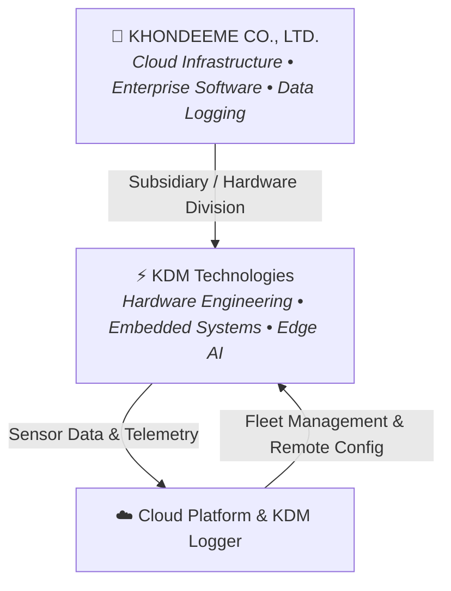

<div align="center">

# KDM Technologies
### Hardware Engineering, Embedded Systems & Edge AI Division

[](https://github.com/khondeeme)
[](https://khondee.me)
[](https://github.com/khondeeme)

<p align="center">
  <b>Bridging physical hardware with intelligent cloud & edge computing.</b><br>
  Custom PCB design, robust embedded firmware, industrial IoT, and Edge AI solutions.
</p>

---

</div>

## 🏢 About KDM Technologies

**KDM Technologies** is the dedicated hardware engineering, embedded systems, and IoT subsidiary of **[KHONDEEME Co., Ltd.](https://khondee.me)**. 

While KHONDEEME leads in enterprise software, cloud infrastructure, and compliance data logging (such as KDM Logger), **KDM Technologies** focuses on the physical and edge layer: designing reliable electronics, high-efficiency microcontrollers, sensor networks, and edge intelligence that seamlessly integrate with cloud backends.

---

## 🎯 Core Focus Areas

```
┌────────────────────────────────────────────────────────────────────────┐
│                          KDM TECHNOLOGIES                              │
├──────────────────┬──────────────────┬──────────────────┬───────────────┤
│ 🔌 Hardware &    │ ⚡ Firmware &     │ 🧠 Edge AI &     │ 🌐 IoT &      │
│    PCB Design    │    Embedded RTOS │    TinyML        │    Telemetry  │
├──────────────────┼──────────────────┼──────────────────┼───────────────┤
│ • Custom Schemat.│ • ESP-IDF/C++    │ • On-device ML   │ • MQTT / MQTTS│
│ • Sensor Carrier │ • Zephyr / RTOS  │ • Edge Vision    │ • LoRaWAN/BLE │
│ • Power Optim.   │ • Secure FOTA    │ • Acoustic AI    │ • Industrial  │
│ • Enclosures/CAD │ • Memory Profile │ • Sensor Fusion  │   Monitoring  │
└──────────────────┴──────────────────┴──────────────────┴───────────────┘
```

- **⚡ Embedded Firmware & RTOS**: Mission-critical firmware running on ESP32, STM32, ARM Cortex-M, and Nordic architectures using modern C/C++, Rust, and FreeRTOS/Zephyr.
- **🧠 Edge AI & TinyML**: Real-time inference on edge processors and microcontrollers (computer vision, anomaly detection, audio event classification).
- **🌐 Connected IoT & Telemetry**: Ultra-low-power telemetry over MQTT/MQTTS, LoRaWAN, BLE, and cellular NB-IoT, built to feed telemetry streams into cloud analytics.
- **🔌 Custom Hardware & PCB Engineering**: Prototyping, schematic capture, multi-layer PCB design, sensor instrumentation, and industrial bus interfaces (RS-485, CAN, Modbus, I2C, SPI).
- **🔒 Hardware Security & Resilience**: Hardware root-of-trust, cryptographic secure boot, encrypted flash, and tamper-resistant Over-The-Air (FOTA) updates.

---

## 🛠️ Technology Stack & Ecosystem

### Hardware & Microcontrollers


### Firmware & Languages


### Connectivity & Industrial Protocols


---

## 🤝 Relationship with KHONDEEME



KDM Technologies works hand-in-hand with [KHONDEEME](https://github.com/khondeeme) to deliver end-to-end technology solutions:
- **From Silicon to Cloud**: Hardware devices stream authenticated logs and metrics directly into KHONDEEME's secure cloud analytics and compliance platforms.
- **Enterprise Grade**: Designed with the same standard of regulatory compliance, data integrity, and high reliability that defines KHONDEEME's core software products.

---

## 🚀 Repositories & Open Initiatives

Our repositories feature:
- 📦 **Firmware Starter Kits**: Production-ready templates for ESP32/STM32 with WiFi, MQTT resilience, and FreeRTOS task setups.
- 📐 **Reference Schematics & Pinouts**: Open hardware documentation and carrier board designs.
- 📡 **Telemetry & Edge Drivers**: Sensor libraries and lightweight edge-protocol connectors.
- 🔬 **TinyML Models & Demos**: Quantized models optimized for low-power edge compute.

---

## 📬 Contact & Connect

- 🌐 **Parent Company Website**: [khondee.me](https://khondee.me)
- 🏢 **GitHub (Parent Company)**: [@khondeeme](https://github.com/khondeeme)
- 💼 **GitHub (Hardware Org)**: [@kdmtechnologies](https://github.com/kdmtechnologies)
- 📧 **Inquiries & Collaborations**: Reach out via [khondee.me/contact](https://khondee.me) or your representative at KHONDEEME.

<div align="center">
<sub>© KDM Technologies / KHONDEEME CO., LTD. All rights reserved.</sub>
</div>
